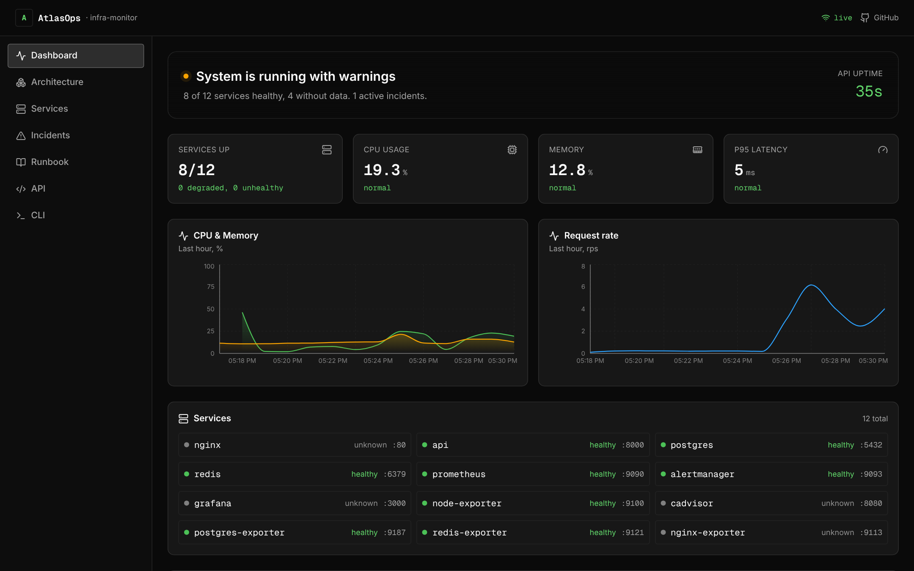
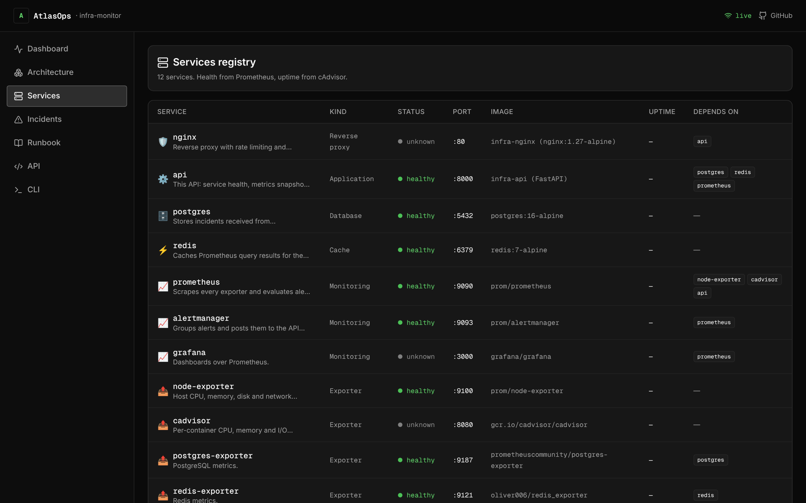
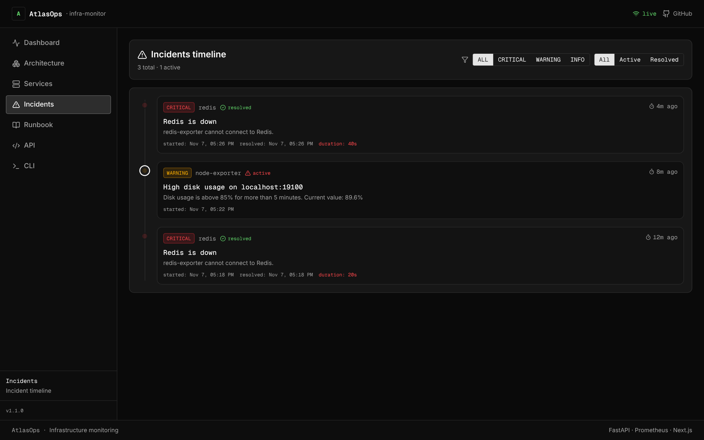
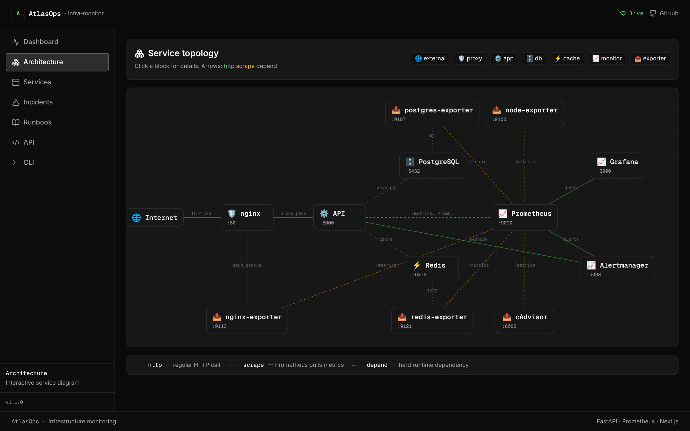

# AtlasOps

[](https://github.com/Imronaxl/atlasops/actions/workflows/ci.yml)

A self-hosted monitoring stack for a Docker host, built with Docker Compose:
Prometheus with node-exporter, cAdvisor and service exporters, alert rules
with unit tests, Alertmanager, provisioned Grafana dashboards, and a small
FastAPI service that turns all of it into one API: live service health,
metric snapshots, and an incident history fed by Alertmanager.



## What runs

```
                          ┌──────────── Prometheus ◄──────────── Grafana
           scrape         │  alert rules  │
  ┌──────────┬────────────┼───────────────┼────────────┐
  ▼          ▼            ▼               ▼            ▼
node-     cAdvisor   postgres-       redis-       nginx-        API /metrics
exporter             exporter        exporter     exporter
                         │               │            │
                     PostgreSQL        Redis        nginx ──► API
                         ▲               ▲                     │  ▲
                         └── incidents ──┴── query cache ──────┘  │
                                                                  │ webhook
                                                    Alertmanager ─┘
```

| Service | Purpose |
|---|---|
| nginx | Reverse proxy for the API: rate limiting, security headers, JSON access logs, `stub_status` |
| api | FastAPI service: `/api/services`, `/api/metrics/snapshot`, `/api/incidents`, Alertmanager webhook |
| postgres | Stores incidents (Alertmanager alerts, firing and resolved) |
| redis | Caches Prometheus answers for the API for 10 s |
| prometheus | Scrapes everything every 15 s, evaluates 16 alert rules |
| alertmanager | Groups alerts and posts them to the API webhook with a bearer token |
| grafana | Datasource and dashboard provisioned from `monitoring/grafana` |
| node-exporter, cadvisor | Host and per-container metrics |
| postgres-, redis-, nginx-exporter | Whether each service actually works (`pg_up`, `redis_up`, `nginx_up`) |

All images are pinned, and every published port is bound to `127.0.0.1`;
put a TLS proxy or a firewall rule in front of nginx for remote access.

## How the API gets its data

- **Service health** is a PromQL query per service, chosen to answer "does it
  work" rather than "is its exporter up": `pg_up` for PostgreSQL, `redis_up`
  for Redis, `up{job="api"}` for the API. Uptime is
  `time() - container_start_time_seconds` from cAdvisor. A service with no
  data is reported as `unknown`, not as healthy.
- **Metric snapshots** are `query_range` calls for the last hour (CPU, memory,
  request rate, p95 latency, error rate). Responses are cached in Redis, and a
  Redis outage only disables the cache.
- **Incidents** come from Alertmanager's webhook. Each alert is upserted by
  `(fingerprint, startsAt)`, so repeated notifications update one row and the
  resolved notification closes it with an end time.
- `/ready` checks PostgreSQL, Redis and Prometheus and returns 503 if any of
  them fails; `/health` is a plain liveness probe.

Request metrics are labelled by route template (`/api/services/{name}`), not
by raw path, so a scanner hitting random URLs cannot blow up label
cardinality.

## Alerts

`monitoring/prometheus/alert.rules.yml`: host CPU, memory, disk and network;
container down, CPU and memory; API latency and 5xx rate; PostgreSQL, Redis
and nginx down; PostgreSQL connection saturation; any scrape target down.

Two rules that are easy to get wrong:

- **ContainerDown** compares containers seen in the last hour with those
  reported now. cAdvisor drops a stopped container's series, so
  `absent(container_last_seen{name=~".+"})` (the usual first attempt) only
  fires when *no* container exists at all.
- **ContainerHighMemory** skips containers without a memory limit, which
  report a limit of 0 and would otherwise divide by zero.

The rules have unit tests (`monitoring/prometheus/tests/alert_rules_test.yml`)
that CI runs with `promtool test rules`.

## Running it

```bash
cp .env.example .env     # change every change_me value
make up                  # docker compose up -d
make healthcheck         # containers, endpoints, disk and memory
```

| | |
|---|---|
| API (through nginx) | http://localhost |
| API (direct) | http://localhost:8000/docs |
| Prometheus | http://localhost:9090 |
| Alertmanager | http://localhost:9093 |
| Grafana | http://localhost:3000 |

Try an incident end to end:

```bash
docker compose stop redis                       # RedisDown fires after 1 minute
curl -s localhost:8000/api/incidents/active     # stored by the webhook
docker compose start redis                      # the incident gets an end time
```

The dashboard runs separately:

```bash
cd web && bun install && bun run dev            # http://localhost:3001
```

It reads the API at `NEXT_PUBLIC_API_URL` (default `http://localhost:8000`);
the API must list the dashboard's origin in `CORS_ORIGINS`.

## Operations

`make help` lists everything. The scripts in `scripts/` pass ShellCheck.

| Command | |
|---|---|
| `make deploy` | Validate compose, build, `up -d`, wait for health checks |
| `make backup` | `pg_dump` to `backups/backup_<timestamp>.sql.gz`, keep 7 days |
| `make restore FILE=…` | Restore a dump after confirmation |
| `make healthcheck` | Exit code 1 if any container or endpoint is unhealthy |
| `make rotate-logs`, `make cleanup` | Log rotation, Docker cleanup |
| `make test`, `make lint` | API tests and alert rule tests; ruff, ShellCheck, promtool, amtool |

`systemd/infra-monitor.service` starts the stack at boot with
`docker compose up --wait`. Operational procedures (deploy, backup, restore,
high CPU, low disk) are also served by the API at `/api/runbook` and shown in
the dashboard.

## Tests and CI

- API tests run against a real PostgreSQL with a fake Prometheus (an
  `httpx.MockTransport`) and fakeredis: health and readiness, service status
  mapping, caching, snapshot parsing, the alert lifecycle and webhook auth.
- `promtool test rules` checks that ContainerDown, PostgresDown and
  HighErrorRate fire when they should and ContainerHighMemory does not fire
  for unlimited containers.
- CI also runs ShellCheck, yamllint, hadolint, `promtool check rules`,
  `amtool check-config`, the dashboard's lint, type check and build, builds
  the images and scans dependencies with Trivy.

## Screenshots

The dashboard below was taken with the API, PostgreSQL, Redis, Prometheus,
Alertmanager, node-exporter and the database exporters running locally;
services that were not started show as `unknown`.

| | |
|---|---|
|  |  |



## License

MIT
